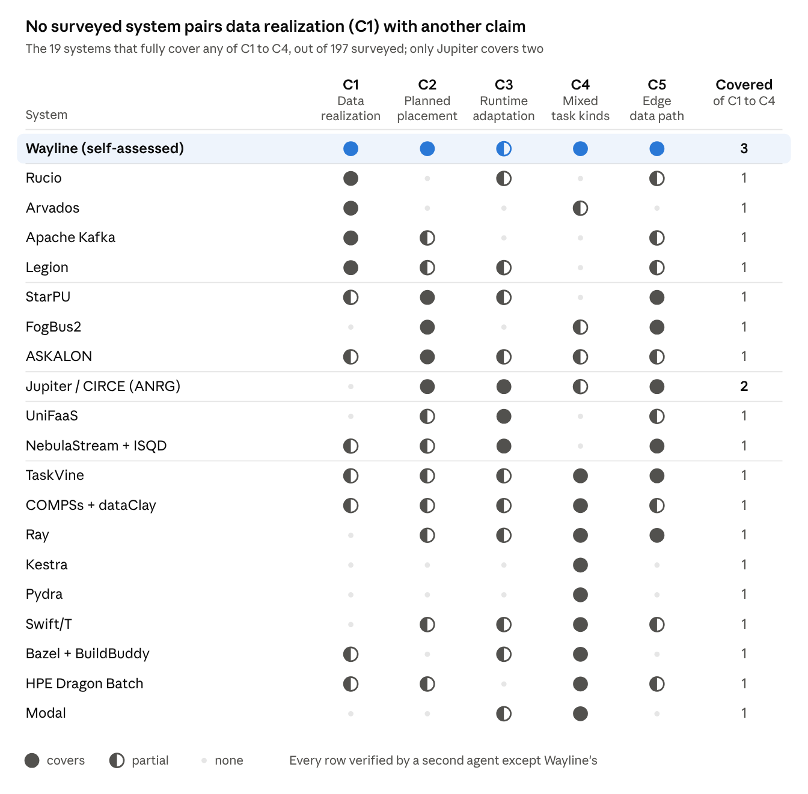

# Wayline in the systems landscape

As of 2026-09-28. Local copy of the shared doc [Wayline in the systems landscape](https://claude.ai/code/artifact/6b3b86a4-0856-4d66-95c2-8a768b5e0edc).

No candidate claim is new on its own. Of 197 systems surveyed in two rounds, 3 or 4 already cover each of C1 to C3, 9 cover C4 and 36 cover C5. No system combines live per-object data realization (C1) with any other claim. The nearest are BitDew for C1 alone and Iridium, which plans extra data copies jointly with task placement, but only for input datasets and never revised on a live run. So Wayline's defensible position is data realization plus planner-driven placement in one edge DAG runtime. The systems to argue against are ANRG's own Jupiter, Rucio and Arvados, Legion, Iridium and TaskVine.

## Claims under test

Each claim is a candidate reason for Wayline to exist as a new framework. A claim survives only if no surveyed system already does it; any one system that does kills it, whatever its field.

| Claim | What Wayline would have to do that others do not | What would falsify it |
| --- | --- | --- |
| C1 Data realization | Decide per output object where its copies live (replicas, serving copy, eviction, durability), and revise that during a live run | A system that controls per-object copy placement for workflow intermediates at run time |
| C2 Faithful planned placement | Run a DAG exactly as a pluggable, heterogeneity-aware planner placed it, with estimates that match reality | A system that accepts external per-task placements and enacts them (Ray already can, so C2 alone is weak) |
| C3 Runtime adaptation | Re-plan tasks not yet started, and their data, when node speed, links or arriving DAGs change | A system that adapts both compute placement and data placement to changing heterogeneity during a run |
| C4 Mixed task kinds | Functions (warm calls) and pods in one DAG, one task contract, one CPU account | A system that runs in-process or warm tasks and container tasks in one DAG (Airflow and Greengrass are suspects) |
| C5 Edge data path | Node-local agents move data peer to peer over heterogeneous links, no central store | An edge or workflow system that passes intermediates peer to peer with link-aware routing |

Axes used to place systems, in the map and the matrix: task kinds; data placement control; compute placement intelligence; runtime adaptation (compute and data); data path topology; edge fit (small, heterogeneous, intermittently connected nodes); resource accounting across task kinds.

## The map

*Survey of 197 systems in two rounds, papers and code checked, September 2026. Wayline row self-assessed.*

Every claim column is filled by systems other than Wayline, so no claim is new alone. Wayline and Jupiter are the only rows with two or more covered claims among C1 to C4, and Jupiter has no C1.

## Capability matrix

The 19 systems that fully cover a claim, the two nearest priors to Wayline's combination (BitDew, Iridium), and the usual baselines. No row except Wayline's and Jupiter's has two filled circles among C1 to C4. ● covers, ◐ partial, · none, after verification. All 197 systems, with the papers and repositories behind each rating, are in [All systems](#all-systems) below.

| System | What it is | C1 | C2 | C3 | C4 | C5 |
| --- | --- | --- | --- | --- | --- | --- |
| **Wayline** (self-assessed) | Edge DAG runtime on Kubernetes | ● | ● | ◐ | ● | ● |
| Rucio | Scientific data management | ● | · | ◐ | · | ◐ |
| Arvados | Workflow platform with Keep storage | ● | · | · | ◐ | · |
| Apache Kafka | Replicated log and streams | ● | ◐ | · | · | ◐ |
| Legion | HPC task runtime with mappers | ● | ◐ | ◐ | · | ◐ |
| BitDew | Data management for desktop grids | ◐ | · | ◐ | · | ◐ |
| Iridium | Geo-distributed analytics | ◐ | ◐ | ◐ | · | ● |
| Jupiter / CIRCE (ANRG) | Edge DAG runtime, dispersed computing | · | ● | ● | ◐ | ● |
| StarPU | Heterogeneous task runtime | ◐ | ● | ◐ | · | ● |
| FogBus2 | Fog and edge framework | · | ● | · | ◐ | ● |
| ASKALON | Grid workflow environment | ◐ | ● | ◐ | ◐ | ◐ |
| UniFaaS | Federated FaaS workflows | · | ◐ | ● | · | ◐ |
| NebulaStream + ISQD | IoT stream processing | ◐ | ◐ | ● | · | ● |
| TaskVine | Data-intensive workflow system | ◐ | ◐ | ◐ | ● | ● |
| COMPSs + dataClay | Task-based programming model | ◐ | ◐ | ◐ | ● | ◐ |
| Ray | Distributed compute framework | · | ◐ | ◐ | ● | ● |
| Kestra | General workflow engine | · | · | · | ● | · |
| Pydra | Dataflow engine | · | · | · | ● | · |
| Swift/T | HPC dataflow language | · | ◐ | ◐ | ● | ◐ |
| Bazel + BuildBuddy | Build DAG with remote execution | ◐ | · | ◐ | ● | · |
| HPE Dragon Batch | HPC workflow runtime | ◐ | ◐ | · | ● | ◐ |
| Modal | Serverless platform | · | · | ◐ | ● | · |
| Argo Workflows | Kubernetes workflow engine | ◐ | ◐ | · | ◐ | · |
| Apache Airflow, multiple executors | Workflow orchestrator | · | ◐ | ◐ | ◐ | · |
| Dask | Distributed compute framework | ◐ | ◐ | ◐ | · | ● |
| Apache Spark | Dataflow engine | ◐ | ◐ | ◐ | ◐ | ◐ |
| Pegasus WMS | Scientific workflow system | ◐ | ◐ | ◐ | ◐ | ◐ |
| KubeEdge + Sedna | Kubernetes at the edge, edge AI | · | · | · | ◐ | ◐ |
| AWS IoT Greengrass v2 | Edge device runtime | ◐ | · | · | ◐ | · |

Partial is a wide band, from Pegasus's static replica catalogs to StarPU's imperative replica calls; the claim-by-claim reasons are in the survey records.

## Closest competitors per claim

Every claim has at least three systems that already cover it; each one lacks the other claims, which is where Wayline sits.

| Claim | System | What it already does | What it lacks |
| --- | --- | --- | --- |
| C1 Data realization | [Rucio](https://arxiv.org/pdf/1902.09857) | Replication rules per file: copy count, target storage (RSE expression), lifetime, locked, source copy. `move_rule`, `reduce_rule` and `add_rule` revise them on a live system; daemons converge storage without re-running jobs | Runs no tasks and places no compute; data moves are not coordinated with any task plan |
| C1 | [Arvados](https://github.com/arvados/arvados) | Each workflow intermediate is a collection with desired replication, storage class and trash time, revisable live; keep-balance pulls and trashes blocks to match | No planner, no speed or link model, no re-planning; containers are bin-packed |
| C1 | [Apache Kafka](https://github.com/apache/kafka) | Partition reassignment sets copy count and exact brokers live; preferred leader is the serving copy; retention evicts | Not a task runtime: no DAG, no task placement |
| C1 | [Legion](https://legion.stanford.edu/pdfs/sc2012.pdf) | The mapper chooses which memories hold copies of each region per task, adds output copies, ranks source copies and sets eviction priority, at run time | One HPC program on Realm processors; no containers, no edge links, planner only partial |
| C1, nearest partial | [BitDew](https://inria.hal.science/inria-00216126/file/RR-6427.pdf) | Each datum has a declared spec (copy count, affinity, lifetime, repair) that a program can revise mid-run; hosts converge on their next sync | Additive only (lowering the count deletes nothing), cannot name nodes, no serving-copy choice or durability control, no planner |
| C1 + C2, nearest to the combination | [Iridium](https://conferences.sigcomm.org/sigcomm/2015/pdf/papers/p421.pdf) | Decides extra copies of input datasets jointly with bandwidth-aware task placement (LP), re-run online as queries arrive | Input datasets only, not intermediates; copies only added; fixed LP, no node-speed model; nothing revised and converged on a live run |
| C2 Planned placement | [Jupiter / CIRCE](https://anrg.usc.edu/www/wp-content/uploads/2019/10/Jupiter__Camera_Ready.pdf) (ANRG, USC) | HEFT variants on profiled per-node run times and per-link transfer curves; each task's pod is pinned to its mapped node; any mapping file can be plugged in | No per-node order enforcement, predictions only logged, no data realization (outputs are copied to consumers, nothing controls copies) |
| C2 | [StarPU](https://inria.hal.science/inria-00550877/document) | Pluggable HEFT-like policies over per-architecture models and a measured bandwidth matrix; an external plan is enacted exactly (worker plus order) with predicted times per task | One runtime for heterogeneous CPUs and GPUs; no containers, no edge DAG |
| C2 | [FogBus2](https://arxiv.org/abs/2108.00591) | Pluggable scheduler using per-node speed and per-link cost; the mapping is enacted exactly with an estimated response time | Placement computed once, never re-planned; no data objects |
| C2 | [ASKALON](https://sigmodrecord.org/publications/sigmodRecord/0509/p56-special-sw-section-9.pdf) | Plug-in HEFT and GA schedulers on predicted run and transfer times; the enactment engine follows the mapping (Grid, 2005) | Grid era; data control only a static repository per output |
| C3 Runtime adaptation | [UniFaaS](https://arxiv.org/abs/2403.19257) | Re-places pending tasks, including ones whose inputs are already staged, when endpoint capacity or backlog changes, and re-stages their inputs (32% makespan gain) | Triggers are capacity and backlog, not measured speed or link drift; no copy control |
| C3 | [Tactical Jupiter](https://anrg.usc.edu/www/papers/Tactical_Jupiter.pdf) (MILCOM 2021) | Re-computes HEFT mappings on new task-graph arrivals and resource changes; outputs follow the new mapping | Paper design, not in the released code; no copy control |
| C3 | [NebulaStream ISQD](https://www.vldb.org/pvldb/vol19/p210-chaudhary.pdf) | Re-places affected operators when nodes or links disappear and migrates their state | Stream operators, one execution kind; bandwidth changes do not trigger re-placement |
| C3, streaming partials | [WASP](https://conservancy.umn.edu/server/api/core/bitstreams/b1d44522-00b8-487b-8a2e-e873236871e5/content), [Tetrium](https://minlanyu.seas.harvard.edu/writeup/eurosys18.pdf), [APEROL](https://www.vldb.org/pvldb/vol19/p156-giatrakos.pdf) | Re-plan operator or task placement on WAN bandwidth drops, stragglers or arrivals | Site-level streaming or analytics; no per-object copy control |
| C4 Mixed task kinds | [TaskVine](https://ccl.cse.nd.edu/assets/pdf/taskvine-works-2023.pdf) | Plain tasks (optionally in containers) and warm FunctionCalls on long-lived libraries in one workflow, one scheduler, one per-worker resource pool | No planner or link model; replica count is one global setting |
| C4 | [COMPSs + dataClay](https://github.com/bsc-wdc/compss) | Warm `@task` functions in piped executors and per-task `@container` runs in one task graph, one scheduler, one resource account | Containers via the engine CLI, not Kubernetes; copy control but no serving-copy choice |
| C4 | [Ray](https://www.usenix.org/system/files/osdi18-moritz.pdf) | Pooled workers and per-task `image_uri` containers in one task graph and one resource pool | `image_uri` is experimental and needs matching Ray and Python in the image; no copy control |
| C4 | Pydra, Swift/T, HPE Dragon Batch, Bazel + BuildBuddy, Modal, Kestra | Warm or in-process tasks beside per-task containers or processes in one graph, with one resource account | No heterogeneity-aware planner and no copy control; C4 is crowded (9 systems) |
| C5 Edge data path | 36 systems, e.g. Ray, Dask, Storm, NiFi, Zenoh, ROS 2, StarPU, Jupiter, Sol, Frontier, Petals | Producers push or peers pull directly, no central store | C5 is not a differentiator |

The C2 and C3 entries include ANRG's own Jupiter family, the first system any reviewer from this community will compare Wayline with.

## The gap

All five claims die alone; one combination survives: live data realization joined to planned placement (C1 + C2), with runtime adaptation (C1 + C3) as the extension still to build.

| Claim or combination | Systems covering it (of 197) | Verdict | Baseline that decides it |
| --- | --- | --- | --- |
| C1 alone | 4 (Rucio, Arvados, Kafka, Legion) | Dead | |
| C2 alone | 4 (Jupiter / CIRCE, StarPU, FogBus2, ASKALON) | Dead | |
| C3 alone | 3 (UniFaaS, Tactical Jupiter, NebulaStream) | Dead | |
| C4 alone | 9 (TaskVine, COMPSs, Ray, Kestra, Pydra, Swift/T, HPE Dragon, Bazel + BuildBuddy, Modal) | Dead | |
| C5 alone | 36 | Dead | |
| C2 + C3 | 1 (Jupiter family) | Dead, and it is ANRG's own work | |
| **C1 + C2** | **0** (43 systems partial on both) | **Open** | Jupiter or Ray with the same planner's placement and no copy control; an Arvados- or Rucio-style static replication rule on the same plan; Iridium-style joint copy and task placement fixed at plan time |
| **C1 + C3** | **0** (56 partial on both) | **Open, not built yet** (Wayline revises data live but does not re-plan compute) | UniFaaS-style re-placement with re-staging; NebulaStream ISQD state migration; WASP |
| C1 + C4 | 0 (38 partial on both) | Open but weak: C4 adds nothing a reader values unless mixing changes placement or data | TaskVine |

What the surviving claim has to show: that deciding task placement and copy placement together, and revising them on a live run, gives a result neither half gets alone. Examples: a planned DAG that survives a node or link loss without re-running producers, or that serves each consumer from the copy the plan expects. Iridium already plans extra copies with task placement for geo-distributed analytics, so the claim has to rest on what Iridium lacks: per-object control of intermediates (not inputs), copies that can also move and be removed, and live revision that the runtime converges to, on heterogeneous edge nodes. A combination is a weaker claim than a new capability, so the experiment has to make the interaction visible, not just list both features.

Wayline's own row is self-assessed, not verified by the survey: it covers C1 (per-object copies, serving copy, eviction, durability, revisable on a live run), C2 (13 SAGA planners, pinned placement, per-node order, predicted against actual) and C4, and only the data half of C3.

## How each system was checked

Every rating in this document comes from a source an agent opened, not from memory, and every rating that threatens a claim was checked twice.

1. **Discovery.** Four independent sweeps (academic edge and continuum systems; open-source edge and pipeline frameworks, including military and IoBT ones; data placement for workflows; runtime adaptation) added 45 systems to a seed list of 64.
2. **Research, one agent per system.** Each agent read the primary paper (PDF converted to text) and the official documentation of the relevant mechanisms. Where the code is open, it cloned the repository and read the files that implement scheduling, data passing, replication, task kinds and adaptation. It then scored the system on eight axes (0 to 3, fixed rubric) and judged each claim as covers, partial or none. Every score of 1 or more cites a quote, a page or a file path the agent opened.
3. **Verification.** A second agent re-opened the sources behind every score of 2 or more and every non-none claim judgement, downgraded what the evidence did not support, and searched for capabilities the first agent missed on C1, C3, C4 and C5.
4. **Gap hunt.** For each claim, two agents (literature; open source and products) tried to find any system, surveyed or not, that already does it. Thirty new systems they found went through steps 2 and 3. In all, 288 agents ran; duplicates merged, 125 systems remain.

A second round researched and verified the 74 unique candidates the first round's caps had left, with the same rubric and evidence rules (148 agents). It included two re-checks of newer releases: Airflow's multiple executors and Flyte 2's reusable containers. Across both rounds, 436 agents surveyed 197 systems.

The rubric favours the competitor: when a system does what a claim describes under different words, it counts as covering it.

## Sources

Across both rounds the research agents opened about 1,600 distinct papers, documentation pages and repositories: papers for 145 systems, code for 179. Every system's links, with the commit inspected, are in [All systems](#all-systems) below. The papers behind the closest competitors are linked in their table above.

## All systems

197 systems in two rounds, one row each, rated after verification: ● covers, ◐ partial, · none. The first table holds round one (125 systems); the second holds round two (74 entries, two of them re-checks of newer releases). Paper and repo link to the pages and code the research agents opened; a blank cell means no paper exists or the code is closed.

### Round one

| System | Category | C1 | C2 | C3 | C4 | C5 | Paper | Code |
| --- | --- | --- | --- | --- | --- | --- | --- | --- |
| Acies-OS | IoBT edge framework | · | · | ◐ | · | ◐ | [paper](https://lass.cs.umass.edu/papers/pdf/icccn24_acies.pdf) | [repo](https://github.com/acies-os/acies-os) |
| Akri | edge device discovery for Kubernetes | · | · | · | · | · | [docs](https://docs.akri.sh/architecture/architecture-overview) | [repo](https://github.com/project-akri/akri) `41e13a8` |
| Alluxio | data orchestration and caching | ◐ | · | · | · | ◐ | [paper](https://www2.eecs.berkeley.edu/Pubs/TechRpts/2018/EECS-2018-29.pdf) | [repo](https://github.com/Alluxio/alluxio) `c0cea82` |
| Apache Airflow | workflow orchestrator | · | ◐ | ◐ | ◐ | · | [docs](https://github.com/apache/airflow/blob/ac88accf4edc6ed70557d5e9554e36adc04ed131/airflow-core/docs/core-concepts/executor/index.rst) | [repo](https://github.com/apache/airflow) `ac88acc` |
| Apache Flink | stream/batch dataflow engine | · | · | ◐ | ◐ | ◐ | [paper](http://sites.computer.org/debull/A15dec/p28.pdf) | [repo](https://github.com/apache/flink) `0897586` |
| Apache Kafka | replicated log and streams | ● | ◐ | · | · | ◐ | [docs](https://github.com/apache/kafka/blob/trunk/docs/operations/basic-kafka-operations.md) | [repo](https://github.com/apache/kafka) `0606659` |
| Apache Nemo | dataflow engine | ◐ | ◐ | ◐ | · | ◐ | [paper](https://www.usenix.org/system/files/atc19-yang-youngseok.pdf) | [repo](https://github.com/apache/incubator-nemo) `03e96cf` |
| Apache NiFi and MiNiFi | dataflow | ◐ | · | ◐ | ◐ | ● | [paper](https://arxiv.org/pdf/2112.09974) | [repo](https://github.com/apache/nifi) |
| Apache OpenWhisk | serverless platform | · | ◐ | · | ◐ | · | [docs](https://github.com/apache/openwhisk/tree/master/docs) | [repo](https://github.com/apache/openwhisk) `a67aba6` |
| Apache Spark | dataflow engine | ◐ | ◐ | ◐ | ◐ | ◐ | [paper](https://www.usenix.org/system/files/conference/nsdi12/nsdi12-final138.pdf) | [repo](https://github.com/apache/spark) `5a05bff` |
| Apache Storm | stream processing | · | ◐ | ◐ | · | ● | [paper](https://arxiv.org/pdf/1904.05456) | [repo](https://github.com/apache/storm) `c2ac7b2` |
| Apollo / dApollo | serverless workflow runtime, cloud continuum | · | ◐ | ◐ | ◐ | ◐ | [paper](https://api.semanticscholar.org/graph/v1/paper/DOI:10.1145/3468737.3494103) | [repo](https://github.com/Apollo-Tools/dApollo) |
| Argo Workflows | container workflow orchestrator | ◐ | ◐ | · | ◐ | · | [docs](https://github.com/argoproj/argo-workflows/blob/main/docs/executor_plugins.md) | [repo](https://github.com/argoproj/argo-workflows) `258ec1b` |
| Arvados | workflow platform with replicated storage | ● | · | · | ◐ | · | [docs](https://doc.arvados.org/user/topics/storage-classes.html) | [repo](https://github.com/arvados/arvados) `dd47076` |
| ASKALON | grid workflow environment | ◐ | ● | ◐ | ◐ | ◐ | [paper](https://sigmodrecord.org/publications/sigmodRecord/0509/p56-special-sw-section-9.pdf) |  |
| AWS IoT Greengrass v2 | edge platform | ◐ | · | · | ◐ | · | [docs](https://docs.aws.amazon.com/greengrass/v2/developerguide/how-it-works.html) | [repo](https://github.com/aws-greengrass/aws-greengrass-nucleus) `ba8bfc4` |
| AWS Step Functions and Lambda | cloud serverless workflow | ◐ | ◐ | · | ◐ | · | [docs](https://docs.aws.amazon.com/step-functions/latest/dg/integrate-services.html) | [repo](https://github.com/aws/aws-lambda-python-runtime-interface-client) `fa006b6` |
| AWStream | adaptive edge analytics research | · | · | ◐ | · | ◐ | [paper](https://awstream.github.io/paper/awstream.pdf) | [repo](https://github.com/awstream/awstream) `c6be66f` |
| Azure Durable Functions | cloud serverless workflow | · | · | ◐ | · | · | [paper](https://www.microsoft.com/en-us/research/wp-content/uploads/2021/10/DF-Semantics-Final.pdf) | [repo](https://github.com/Azure/azure-functions-durable-extension) `05dd56e` |
| Azure IoT Edge | edge platform | ◐ | · | · | ◐ | ◐ | [docs](https://learn.microsoft.com/en-us/azure/iot-edge/module-composition) | [repo](https://github.com/Azure/iotedge) `e3584a3` |
| Baetyl | edge computing framework | · | · | · | ◐ | · | [paper](https://arxiv.org/abs/2401.01217) | [repo](https://github.com/baetyl/baetyl) |
| Boki | serverless research | ◐ | · | · | · | · | [paper](https://www.cs.utexas.edu/users/witchel/pubs/jia21sosp-boki.pdf) | [repo](https://github.com/ut-osa/boki) `8e8c9ca` |
| Caribou | multi-region serverless workflows | · | ◐ | ◐ | · | · | [paper](https://cirrus.ece.ubc.ca/papers/sosp24_caribou.pdf) | [repo](https://github.com/ubc-cirrus-lab/caribou) `fea32e7` |
| Cloudburst | serverless research | ◐ | ◐ | · | · | ◐ | [paper](https://www.vldb.org/pvldb/vol13/p2438-sreekanti.pdf) | [repo](https://github.com/hydro-project/cloudburst) |
| ClusterLess | federated serverless workflow orchestrator | · | ◐ | ◐ | ◐ | ◐ | [paper](https://arxiv.org/pdf/2605.04310) |  |
| COMPSs + dataClay | task-based programming model and runtime | ◐ | ◐ | ◐ | ● | ◐ | [paper](https://upcommons.upc.edu/bitstreams/04816117-6834-457f-83b5-b58aac2b4c15/download) | [repo](https://github.com/bsc-wdc/compss) |
| Covalent | Python workflow orchestrator | · | · | · | ◐ | · | [docs](https://github.com/AgnostiqHQ/covalent/tree/develop/doc/source) | [repo](https://github.com/AgnostiqHQ/covalent) `1e3da80` |
| DAG-aware Kubernetes scheduler (Marchese & Tomarchio) | Kubernetes scheduler and descheduler | · | ◐ | ◐ | · | ◐ | [paper](https://ceur-ws.org/Vol-3606/paper62.pdf) |  |
| Dagster | workflow orchestrator | ◐ | ◐ | ◐ | ◐ | · | [paper](https://arxiv.org/pdf/2408.11635) | [repo](https://github.com/dagster-io/dagster) `a148082` |
| Dapr Workflow | durable workflow runtime | · | · | · | ◐ | · | [docs](https://docs.dapr.io/developing-applications/building-blocks/workflow/workflow-overview/) | [repo](https://github.com/dapr/dapr) `378f9fc` |
| Dask | distributed compute framework | ◐ | ◐ | ◐ | · | ● | [paper](https://proceedings.scipy.org/articles/Majora-7b98e3ed-013.pdf) | [repo](https://github.com/dask/distributed) `dc182bd` |
| Databelt / Truffle | serverless workflow data path, edge | ◐ | ◐ | ◐ | · | ● | [paper](https://arxiv.org/pdf/2508.15351) | [repo](https://github.com/polaris-slo-cloud/databelt) |
| DataFlower | serverless workflow research | · | ◐ | · | · | ◐ | [paper](https://arxiv.org/pdf/2304.14629) | [repo](https://github.com/lzjzx1122/FaaSFlow) `ac7b9b5` |
| dCache QoS | storage system with QoS policies | ◐ | · | · | · | · | [docs](https://github.com/dCache/dcache/blob/master/docs/TheBook/src/main/markdown/cookbook-qos-policies.md) | [repo](https://github.com/dCache/dcache) `46a26ce` |
| dora-rs | robotics and AI dataflow middleware | · | ◐ | · | ◐ | ● | [docs](https://dora-rs.ai/dora/operations/distributed) | [repo](https://github.com/dora-rs/dora) `3d3a90d` |
| ECHO | edge, fog and cloud dataflow | · | ◐ | ◐ | ◐ | ● | [paper](https://arxiv.org/abs/1707.00889) | [repo](https://github.com/dream-lab/echo) `3ba3e83` |
| Eclipse ioFog | edge platform | ◐ | · | · | ◐ | ◐ | [paper](https://pmc.ncbi.nlm.nih.gov/articles/PMC10143384/) | [repo](https://github.com/eclipse-iofog/Controller) |
| Eclipse Zenoh + Zenoh-Flow | edge data fabric | ◐ | ◐ | · | · | ● | [paper](https://zenodo.org/api/records/10635550/files/Zenoh-Unifying%20communication,%20storage,%20and%20computation%20from%20the%20cloud%20to%20the%20microcontroller.pdf/content) | [repo](https://github.com/eclipse-zenoh/zenoh) |
| EdgeFaaS | IoT edge-cloud function framework | ◐ | ◐ | · | · | ◐ | [paper](https://arxiv.org/pdf/2607.14489) |  |
| EdgeWise | edge stream processing research | · | ◐ | ◐ | · | ● | [paper](https://www.usenix.org/system/files/atc19-fu.pdf) | [repo](https://github.com/VTLeeLab/EdgeWise-ATC-19) `525fd9c` |
| EdgeWorkflow | edge workflow management system | · | ◐ | · | · | · | [paper](https://nzjohng.github.io/publications/papers/jss2022_2.pdf) | [repo](https://github.com/ISEC-AHU/EdgeWorkflow) `a377720` |
| EdgeX Foundry | edge platform | · | · | · | · | · | [paper](https://arxiv.org/pdf/1911.02794) | [repo](https://github.com/edgexfoundry) |
| ElfStore | edge/fog federated data store | ◐ | · | · | · | ◐ | [paper](https://arxiv.org/abs/1905.08932) | [repo](https://github.com/dream-lab/ElfStore) `117676a` |
| Ermes | stateful serverless platform, edge | ◐ | ◐ | ◐ | · | ◐ | [paper](https://arxiv.org/abs/2609.18924) |  |
| FaaSFlow | serverless workflow research | ◐ | ◐ | ◐ | · | ◐ | [paper](https://arxiv.org/pdf/2304.14629) | [repo](https://github.com/lzjzx1122/FaaSFlow) `ac7b9b5` |
| Faasm | serverless research | · | ◐ | ◐ | · | ◐ | [paper](https://www.usenix.org/system/files/atc20-shillaker.pdf) | [repo](https://github.com/faasm/faasm) |
| FaDO | multi-cluster serverless functions and data | ◐ | · | · | · | · | [paper](https://anshul-jindal.me/publication/fado/fado.pdf) | [repo](https://github.com/smithyworks/FaDO) `8ed07d9` |
| Fission | serverless platform | · | · | · | ◐ | · | [paper](https://repository.tudelft.nl/file/File_92630643-f3e3-4490-8539-c26650340242) | [repo](https://github.com/fission/fission) `254f443` |
| Fluid | Kubernetes dataset orchestration and caching | ◐ | · | · | · | ◐ | [paper](https://api.semanticscholar.org/graph/v1/paper/DOI:10.1109/tpds.2023.3314659) | [repo](https://github.com/fluid-cloudnative/fluid) `e0fc4c1` |
| Flyte | container workflow orchestrator | ◐ | · | · | ◐ | · | [paper](https://proceedings.scipy.org/articles/DDJJ4932) | [repo](https://github.com/flyteorg/flyte) |
| FogBus2 | fog and edge framework | · | ● | · | ◐ | ● | [paper](https://arxiv.org/abs/2108.00591) | [repo](https://github.com/Cloudslab/FogBus2) `5dc291c` |
| FogFlow | edge/fog dataflow | · | · | ◐ | · | ● | [paper](https://arxiv.org/abs/1907.08278) | [repo](https://github.com/smartfog/fogflow) `e44329b` |
| FReD + Enoki | fog data replication middleware | ◐ | · | · | · | ◐ | [paper](https://arxiv.org/abs/2303.05256) | [repo](https://github.com/OpenFogStack/FReD) |
| Galaxy | scientific workflow platform | ◐ | ◐ | ◐ | ◐ | · | [paper](https://www.ebi.ac.uk/europepmc/webservices/rest/PMC11223835/fullTextXML) | [repo](https://github.com/galaxyproject/galaxy) `5e6568f` |
| GeoFF | federated serverless workflow choreography | · | · | · | · | ◐ | [paper](https://arxiv.org/pdf/2405.13594) | [repo](https://github.com/valentin-carl/federation) `b7bb0d7` |
| Globus Compute | federated function-as-a-service | ◐ | · | · | ◐ | ◐ | [paper](https://arxiv.org/pdf/2005.04215) | [repo](https://github.com/globus/globus-compute) `81472aa` |
| HashiCorp Nomad | cluster scheduler | ◐ | ◐ | ◐ | ◐ | · | [docs](https://developer.hashicorp.com/nomad/docs/concepts/scheduling/how-scheduling-works) | [repo](https://github.com/hashicorp/nomad) `3f30476` |
| HDFS | distributed file system | ◐ | · | ◐ | · | ◐ | [paper](https://pages.cs.wisc.edu/~akella/CS838/F15/838-CloudPapers/hdfs.pdf) | [repo](https://github.com/apache/hadoop) `8545d5e` |
| HEFTLess | serverless workflow batch orchestrator | · | ◐ | · | ◐ | · | [paper](https://ieeexplore.ieee.org/abstract/document/10740904) | [repo](https://github.com/serverledge-faas/serverledge) `45419f5` |
| Hermes | HPC multi-tier I/O buffering | ◐ | · | · | · | ◐ | [paper](http://www.cs.iit.edu/~scs/assets/files/Hermes.pdf) | [repo](https://github.com/HDFGroup/hermes) `abbf26e` |
| Hi-WAY | scientific workflows on YARN | · | ◐ | ◐ | · | ◐ | [paper](https://openproceedings.org/2017/conf/edbt/paper-248.pdf) | [repo](https://github.com/marcbux/Hi-WAY) `5fec3db` |
| HiveMind | serverless edge hardware-software stack | ◐ | ◐ | ◐ | ◐ | ◐ | [paper](https://arxiv.org/abs/2112.14831) |  |
| HTCondor CacheD | high-throughput computing, data caching | ◐ | · | ◐ | · | ◐ | [paper](https://arxiv.org/abs/2004.05729) | [repo](https://github.com/zzxuanyuan/htcondor) `8e55444` |
| IPFS Cluster | distributed pinning and replicas | ◐ | · | · | · | ◐ | [docs](https://ipfscluster.io/documentation/guides/pinning/) | [repo](https://github.com/ipfs-cluster/ipfs-cluster) `60b35f2` |
| iRODS | policy-based data management | ◐ | · | · | ◐ | ◐ | [paper](https://jodi-ojs-tdl.tdl.org/jodi/article/view/756/644) | [repo](https://github.com/irods/irods) `84b9f9a` |
| Jiffy | serverless ephemeral storage research | ◐ | · | · | · | · | [paper](http://faculty.washington.edu/wlloyd/courses/tcss591/papers/JiffyElasticFar-memoryForStatefulServerlessAnalytics.pdf) | [repo](https://github.com/resource-disaggregation/jiffy) `48479f3` |
| Jupiter / CIRCE (ANRG, USC) | edge DAG runtime, dispersed computing | · | ● | ● | ◐ | ● | [paper](https://anrg.usc.edu/www/wp-content/uploads/2019/10/Jupiter__Camera_Ready.pdf) | [repo](https://github.com/ANRGUSC/Jupiter) |
| Kestra | general workflow engine | · | · | · | ● | · | [docs](https://kestra.io/docs/task-runners/types) | [repo](https://github.com/kestra-io/kestra) `d0b0435` |
| Knative | serverless platform | ◐ | · | ◐ | ◐ | ◐ | [docs](https://knative.dev/docs/eventing/flows/sequence/) | [repo](https://github.com/knative/serving) |
| KubeAdaptor | cloud-native workflow engine | · | ◐ | · | · | · | [paper](https://arxiv.org/pdf/2207.01222) | [repo](https://github.com/CloudControlSystems/KubeAdaptor) `59f9ec7` |
| KubeEdge + Sedna | edge platform | · | · | · | ◐ | ◐ | [paper](https://acm-ieee-sec.org/2018/pdfs/SEC2018-5cLAs0rQH8wBym0gnRmRKv/5ZjYOIzvugB9geU0moDCYi/4QFQJTAEEuxp945BKw68sQ.pdf) | [repo](https://github.com/kubeedge/sedna) |
| Kubeflow Pipelines | container workflow orchestrator | ◐ | ◐ | ◐ | · | · | [docs](https://www.kubeflow.org/docs/components/pipelines/concepts/pipeline-root/) | [repo](https://github.com/kubeflow/pipelines) `90ef71f` |
| Kubernetes scheduler-plugins | cluster scheduler | · | ◐ | ◐ | · | · | [paper](https://biblio.ugent.be/publication/01HMBW44FEJ9AVQNYWJSR7EC2S) | [repo](https://github.com/kubernetes-sigs/scheduler-plugins) `3ae4493` |
| Legion | HPC task runtime with mappers | ● | ◐ | ◐ | · | ◐ | [paper](https://legion.stanford.edu/pdfs/sc2012.pdf) | [repo](https://github.com/StanfordLegion/legion) `c109666` |
| LF Edge eKuiper | edge stream processing | · | · | · | ◐ | ◐ | [docs](https://ekuiper.org/docs/en/latest/concepts/ekuiper.html) | [repo](https://github.com/lf-edge/ekuiper) `c3d93e3` |
| LF Edge Open Horizon | edge workload and data distribution | ◐ | · | · | · | · | [docs](https://github.com/open-horizon/anax/tree/master/docs) | [repo](https://github.com/open-horizon/edge-sync-service) |
| Longhorn | Kubernetes block storage | ◐ | · | · | · | ◐ | [docs](https://longhorn.io/docs/1.7.0/high-availability/data-locality/) | [repo](https://github.com/longhorn/longhorn-manager) `5a4453b` |
| Lustre FLR | parallel file system | ◐ | · | · | · | · | [docs](https://wiki.lustre.org/File_Level_Redundancy_Solution_Architecture) | [repo](https://github.com/lustre/lustre-release) `550451c` |
| Maestro core middleware | HPC data middleware | ◐ | · | · | · | ◐ | [paper](https://web.archive.org/web/2023/https://hal.inria.fr/hal-03313021/document) | [repo](https://gitlab.jsc.fz-juelich.de/maestro/maestro-core) `fac0268` |
| Metaflow | workflow orchestrator | · | · | · | ◐ | · | [docs](https://github.com/Netflix/metaflow/blob/master/docs/datastore.md) | [repo](https://github.com/Netflix/metaflow) `8b500da` |
| NATS JetStream | streams and object store | ◐ | · | · | · | ◐ | [docs](https://github.com/nats-io/nats.docs/blob/master/nats-concepts/jetstream/streams.md) | [repo](https://github.com/nats-io/nats-server) |
| NebulaStream + ISQD | IoT stream processing engine | ◐ | ◐ | ● | · | ● | [paper](https://www.vldb.org/pvldb/vol19/p210-chaudhary.pdf) | [repo](https://github.com/nebulastream/nebulastream) |
| Nextflow | scientific workflow | ◐ | · | · | ◐ | · | [paper](https://tcoffee.org/Courses/Exercises/2017_bologna_ma/biblio/nextflow2017.pdf) | [repo](https://github.com/nextflow-io/nextflow) `ddc1e30` |
| Nightcore | serverless research | · | · | ◐ | · | · | [paper](https://www.cs.utexas.edu/~witchel/pubs/jia21asplos-nightcore.pdf) | [repo](https://github.com/ut-osa/nightcore) `f041db0` |
| Node-RED | flow-based edge programming | · | · | · | ◐ | ◐ | [paper](https://arxiv.org/abs/1810.11287) | [repo](https://github.com/node-red/node-red) `1e85f1e` |
| Nuclio | serverless platform | · | · | · | ◐ | ◐ | [docs](https://docs.nuclio.io/en/stable/concepts/architecture.html) | [repo](https://github.com/nuclio/nuclio) `4d05c64` |
| NVIDIA DeepStream | edge streaming analytics | · | · | · | · | ◐ | [docs](https://docs.nvidia.com/metropolis/deepstream/dev-guide/text/DS_Overview.html) | [repo](https://github.com/NVIDIA/DeepStream) `0a63ef8` |
| NVIDIA Holoscan SDK | sensor and AI streaming SDK | · | ◐ | · | · | ● | [docs](https://docs.nvidia.com/holoscan/sdk-user-guide/holoscan_create_distributed_app.html) | [repo](https://github.com/nvidia-holoscan/holoscan-sdk) `66a9609` |
| Oakestra | hierarchical edge orchestration | · | · | ◐ | ◐ | ◐ | [paper](https://www.usenix.org/system/files/atc23-bartolomeo.pdf) | [repo](https://github.com/oakestra/oakestra) |
| Onedata | distributed data management | ◐ | · | ◐ | ◐ | ◐ | [docs](https://github.com/onedata/onedata-documentation/blob/develop/docs/user-guide/rule-based-replication-qos.md) | [repo](https://github.com/onedata/op-worker) |
| OpenFaaS | serverless platform | · | · | · | ◐ | ◐ | [docs](https://docs.openfaas.com/reference/workloads/) | [repo](https://github.com/openfaas/faas) |
| OpenWolf | edge-cloud serverless workflow engine | · | · | · | · | · | [paper](https://cris.unibo.it/bitstream/11585/961418/3/Siotec_23_Copy_.pdf) | [repo](https://github.com/christiansicari/OpenWolf) `d9da99f` |
| OpenYurt | edge platform | · | · | · | · | · | [docs](https://github.com/openyurtio/openyurt/blob/master/docs/proposals/20231205-yurt-express.md) | [repo](https://github.com/openyurtio/openyurt) `7833349` |
| OSCAR | serverless platform on Kubernetes | ◐ | · | ◐ | ◐ | · | [paper](https://www.grycap.upv.es/gmolto/publications/preprints/Risco2023rsw.pdf) | [repo](https://github.com/grycap/oscar) |
| Palette | serverless locality research | ◐ | ◐ | ◐ | · | ◐ | [paper](https://www.microsoft.com/en-us/research/wp-content/uploads/2022/10/palette-eurosys23.pdf) |  |
| PanDA / JEDI + iDDS with Rucio | HEP workload and data management | ◐ | ◐ | ◐ | ◐ | ◐ | [paper](https://arxiv.org/abs/2510.02930) | [repo](https://github.com/HSF/iDDS) |
| Parsl | parallel scripting / workflow | ◐ | · | ◐ | ◐ | ◐ | [paper](https://arxiv.org/pdf/1905.02158) | [repo](https://github.com/Parsl/parsl) `91295d0` |
| Pegasus WMS | scientific workflow + data management | ◐ | ◐ | ◐ | ◐ | ◐ | [paper](https://rafaelsilva.com/files/publications/deelman-fgcs-2015.pdf) | [repo](https://github.com/pegasus-isi/pegasus) `51a7ffb` |
| Pheromone | serverless workflow research | ◐ | · | ◐ | · | ◐ | [paper](https://www.usenix.org/system/files/nsdi23-yu.pdf) | [repo](https://github.com/MincYu/pheromone) `4d22677` |
| Pocket | serverless ephemeral storage research | ◐ | · | · | · | · | [paper](https://www.usenix.org/system/files/osdi18-klimovic.pdf) | [repo](https://github.com/stanford-mast/pocket) `2cec4cc` |
| Prefect | workflow orchestrator | ◐ | · | · | ◐ | · | [docs](https://docs.prefect.io/v3/concepts/task-runners) | [repo](https://github.com/PrefectHQ/prefect) `4f52bc6` |
| Ray | distributed compute framework | · | ◐ | ◐ | ● | ● | [paper](https://www.usenix.org/system/files/osdi18-moritz.pdf) | [repo](https://github.com/ray-project/ray) `e70ad5f` |
| ROS 2 | robotics dataflow middleware | ◐ | · | · | ◐ | ● | [paper](https://arxiv.org/pdf/2211.07752) | [repo](https://github.com/ros2/rclcpp) |
| Rucio | scientific data management | ● | · | ◐ | · | ◐ | [paper](https://arxiv.org/pdf/1902.09857) | [repo](https://github.com/rucio/rucio) `5a4c2e1` |
| SAND / KNIX | serverless research | · | · | · | ◐ | ◐ | [paper](https://www.usenix.org/system/files/conference/atc18/atc18-akkus.pdf) | [repo](https://github.com/knix-microfunctions/knix) `fac5caf` |
| Serverledge | edge-cloud FaaS with offloading | · | ◐ | ◐ | · | ◐ | [paper](http://www.ce.uniroma2.it/publications/serverledgePerCom2023.pdf) | [repo](https://github.com/serverledge-faas/serverledge) `45419f5` |
| Snakemake | scientific workflow | ◐ | ◐ | · | ◐ | · | [paper](https://f1000research.com/articles/10-33/v2/pdf) | [repo](https://github.com/snakemake/snakemake) |
| SONIC | serverless data passing research | ◐ | ◐ | ◐ | · | ◐ | [paper](https://www.usenix.org/system/files/atc21-mahgoub.pdf) |  |
| StarPU | heterogeneous task runtime | ◐ | ● | ◐ | · | ● | [paper](https://inria.hal.science/inria-00550877/document) | [repo](https://github.com/starpu-runtime/starpu) `0198d1b` |
| StreamFlow | hybrid CWL workflow manager | · | ◐ | · | ◐ | ◐ | [paper](https://arxiv.org/abs/2002.01558) | [repo](https://github.com/alpha-unito/streamflow) `e275409` |
| TaskVine | data-intensive workflow system | ◐ | ◐ | ◐ | ● | ● | [paper](https://ccl.cse.nd.edu/assets/pdf/taskvine-works-2023.pdf) | [repo](https://github.com/cooperative-computing-lab/cctools) `ff9e0b9` |
| Tekton Pipelines | container workflow orchestrator | ◐ | ◐ | ◐ | ◐ | · | [docs](https://github.com/tektoncd/pipeline/blob/main/docs/affinityassistants.md) | [repo](https://github.com/tektoncd/pipeline) `54474a9` |
| Temporal | durable execution | ◐ | ◐ | ◐ | ◐ | · | [docs](https://github.com/temporalio/documentation) | [repo](https://github.com/temporalio/temporal) |
| TiDB placement rules | distributed database placement | ◐ | · | ◐ | · | ◐ | [paper](https://www.vldb.org/pvldb/vol13/p3072-huang.pdf) | [repo](https://github.com/tikv/pd) |
| Toil | scientific workflow (CWL/WDL) | · | · | · | ◐ | · | [paper](https://eutils.ncbi.nlm.nih.gov/entrez/eutils/efetch.fcgi?db=pmc&id=5546205&rettype=xml) | [repo](https://github.com/DataBiosphere/toil) `a807429` |
| UniFaaS | federated FaaS workflows | · | ◐ | ● | · | ◐ | [paper](https://arxiv.org/abs/2403.19257) | [repo](https://github.com/SUSTech-HPCLab/UniFaaS) `dd0d900` |
| Unum | serverless workflow research | · | · | · | · | · | [paper](https://www.usenix.org/system/files/nsdi23-liu-david.pdf) | [repo](https://github.com/LedgeDash/unum) `8979d47` |
| Vineyard (v6d) | Kubernetes data plane for workflow data | ◐ | · | · | · | ◐ | [paper](https://v6d.io/vineyard-sigmod-2023.pdf) | [repo](https://github.com/v6d-io/v6d) `0cbaada` |
| Volcano | batch scheduler for Kubernetes | · | ◐ | ◐ | ◐ | · | [docs](https://github.com/volcano-sh/volcano/blob/master/docs/design/jobflow/README.md) | [repo](https://github.com/volcano-sh/volcano) |
| wasm-workflows-plugin | mixed-kind Kubernetes DAG extension | · | · | · | ◐ | · | [docs](https://github.com/Shark/wasm-workflows-plugin/blob/main/doc/distributed-mode.md) | [repo](https://github.com/Shark/wasm-workflows-plugin) `f949720` |
| wasmCloud | distributed Wasm platform | · | · | · | ◐ | ◐ | [docs](https://wasmcloud.com/docs/concepts/lattice/) | [repo](https://github.com/wasmCloud/wasmCloud) `b8140c7` |
| Windmill | workflow engine with warm workers | · | ◐ | ◐ | ◐ | · | [docs](https://www.windmill.dev/docs/core_concepts/dedicated_workers) | [repo](https://github.com/windmill-labs/windmill) `651a6b0` |
| WOSS / MosaStore | workflow-optimized storage | ◐ | · | · | · | ◐ | [paper](https://arxiv.org/abs/1301.6195) |  |
| WOW (Common Workflow Scheduler) | workflow scheduler + data placement service | ◐ | ◐ | ◐ | ◐ | ● | [paper](https://arxiv.org/pdf/2503.13072) | [repo](https://github.com/WOW-WorkflowScheduler/KubernetesScheduler) `fd30987` |
| Wukong | serverless DAG research | · | · | ◐ | · | ◐ | [paper](https://arxiv.org/pdf/2010.07268) | [repo](https://github.com/ds2-lab/Wukong) `62f8dc7` |

### Round two

The 74 unique candidates the first round's caps had left. None covers C1, C2 or C3; five more cover C4 and 18 more cover C5.

| System | Category | C1 | C2 | C3 | C4 | C5 | Paper | Code |
| --- | --- | --- | --- | --- | --- | --- | --- | --- |
| ADIOS2 SST and DataSpaces staging | HPC data staging | ◐ | · | ◐ | · | ◐ | [paper](https://www.osti.gov/servlets/purl/3002190) | [repo](https://github.com/ornladios/ADIOS2) |
| AI-SPRINT SPACE4AI-R | edge-cloud DAG placement optimizer | ◐ | ◐ | ◐ | ◐ | ◐ | [paper](https://re.public.polimi.it/bitstream/11311/1254210/1/S4AIR_DMLICC2023__iris_.pdf) | [repo](https://github.com/ai-sprint-eu-project/space4ai-r-runtime-manager) `82c646d` |
| AiiDA | scientific workflow engine | ◐ | · | · | ◐ | · | [paper](https://arxiv.org/pdf/2003.12476) | [repo](https://github.com/aiidateam/aiida-core) `c990648` |
| Amazon SageMaker Pipelines | cloud ML pipelines | · | · | · | ◐ | · | [docs](https://docs.aws.amazon.com/sagemaker/latest/dg/build-and-manage-steps-types.html) | [repo](https://github.com/aws/sagemaker-python-sdk) `4f3cc56` |
| Anna | tiered key-value store | ◐ | · | ◐ | · | · | [paper](http://www.vldb.org/pvldb/vol12/p624-wu.pdf) | [repo](https://github.com/hydro-project/anna) `53956c9` |
| Apache Airflow, multiple executors (re-check) | workflow orchestrator | · | · | · | ◐ | · | [docs](https://airflow.apache.org/docs/apache-airflow/stable/core-concepts/executor/index.html) | [repo](https://github.com/apache/airflow) `0768924` |
| Apache DolphinScheduler | workflow scheduler | · | · | ◐ | ◐ | · | [docs](https://github.com/apache/dolphinscheduler/blob/dev/docs/docs/en/guide/task/kubernetes.md) | [repo](https://github.com/apache/dolphinscheduler) `7cf1677` |
| Apache Tez + Hive LLAP | dataflow engine | · | ◐ | ◐ | ◐ | ◐ | [paper](https://web.eecs.umich.edu/~mosharaf/Readings/Tez.pdf) | [repo](https://github.com/apache/tez) |
| APEROL and DAG* | edge-to-cloud streaming placement | · | ◐ | ◐ | ◐ | ◐ | [paper](https://www.vldb.org/pvldb/vol19/p156-giatrakos.pdf) | [repo](https://github.com/DBanelas/aperol) |
| Bacalhau | compute-over-data orchestrator | ◐ | · | · | ◐ | ◐ | [docs](https://bacalhau.org/docs/) | [repo](https://github.com/bacalhau-project/bacalhau) `0674b60` |
| Bazel + BuildBuddy | build DAG with remote execution | ◐ | · | ◐ | ● | · | [docs](https://github.com/buildbuddy-io/buildbuddy/blob/master/docs/rbe-platforms.md) | [repo](https://github.com/buildbuddy-io/buildbuddy) `c0142ac` |
| BitDew | data management for desktop grids | ◐ | · | ◐ | · | ◐ | [paper](https://inria.hal.science/inria-00216126/file/RR-6427.pdf) | [repo](https://github.com/gfedak/bitdew) `9f602db` |
| Calvin | IoT actor dataflow | · | ◐ | ◐ | · | ● | [paper](http://web.archive.org/web/20221221085201/https://www.sciencedirect.com/science/article/pii/S1877050915008595) | [repo](https://github.com/EricssonResearch/calvin-base) `bc4645c` |
| CEDR | heterogeneous SoC DAG runtime | · | ◐ | ◐ | · | · | [paper](https://arxiv.org/pdf/2204.08962v1) | [repo](https://github.com/UA-RCL/CEDR) `96eeda6` |
| CIEL | dynamic task-DAG engine | · | · | ◐ | ◐ | ◐ | [paper](https://www.usenix.org/legacy/event/nsdi11/tech/full_papers/Murray.pdf) | [repo](https://github.com/mrry/ciel) `cb44d55` |
| Clarinet | WAN-aware analytics | · | ◐ | ◐ | · | ● | [paper](https://www.usenix.org/system/files/conference/osdi16/osdi16-viswanathan.pdf) | [repo](https://github.com/raajay/tez) `f715649` |
| CODECO workload placement | Kubernetes QoS scheduler | · | ◐ | ◐ | · | ◐ | [paper](https://arxiv.org/abs/2601.13351) | [repo](https://gitlab.eclipse.org/eclipse-research-labs/codeco-project/scheduling-and-workload-migration-swm/qos-scheduler) |
| Compute First Networking | ICN edge computing | · | · | ◐ | · | ● | [paper](https://conferences.sigcomm.org/acm-icn/2019/proceedings/icn19-16.pdf) | [repo](https://github.com/spirosmastorakis/CFN) |
| COSCO + MCDS | edge-cloud workflow scheduling | · | ◐ | ◐ | · | · | [paper](https://arxiv.org/abs/2112.07269) | [repo](https://github.com/imperial-qore/MCDS) `169b873` |
| Dagger.jl | Julia task runtime | ◐ | ◐ | ◐ | · | ◐ | [paper](https://api.semanticscholar.org/graph/v1/paper/DOI:10.1109/HPEC62836.2024.10938467) | [repo](https://github.com/JuliaParallel/Dagger.jl) `3378c9a` |
| DataCloud ADA-PIPE | big-data pipeline runtime | · | ◐ | ◐ | · | ◐ | [paper](https://arxiv.org/abs/2504.03698) | [repo](https://github.com/DataCloud-project/ADA-PIPE) `72531d0` |
| DDFlow | IoT macroprogramming | · | ◐ | ◐ | · | ● | [paper](http://web.archive.org/web/20200219072911id_/https://pdfs.semanticscholar.org/ef16/b2e15272804c84d69869fd6252489cc61aac.pdf) | [repo](https://github.com/nesl/DDFlow) `3c1b760` |
| Decima | learned DAG scheduler | · | · | ◐ | · | ◐ | [paper](https://arxiv.org/abs/1810.01963) | [repo](https://github.com/hongzimao/decima-sim) `c010dd7` |
| Delta scheduler for funcX | federated function scheduler | · | ◐ | ◐ | · | ◐ | [paper](https://rohankumar.io/continuum_thesis.pdf) | [repo](https://github.com/rohankumar42/delta) `0de889d` |
| Direktiv v0.5.x | Kubernetes workflow engine | · | · | · | ◐ | · | [docs](https://web.archive.org/web/20220123214209/https://docs.direktiv.io/v0.5.10/getting_started/isolated-functions/) | [repo](https://github.com/direktiv/direktiv) `b36e97a` |
| Distream | camera analytics | · | ◐ | ◐ | · | ◐ | [paper](https://mi-zhang.github.io/papers/2020_SenSys_Distream.pdf) | [repo](https://github.com/AIoT-MLSys-Lab/Distream) `ed0296f` |
| DYAD | HPC file staging | · | · | · | · | ◐ | [paper](https://github.com/flux-framework/dyad/blob/main/docs/_static/Paper_2024_SBACPAD_DYAD.pdf) | [repo](https://github.com/flux-framework/dyad) `5cbdb6b` |
| EdgeFlow | multi-tier stream offloading | · | ◐ | ◐ | · | ◐ | [paper](https://arxiv.org/pdf/1801.02206) | [repo](https://github.com/sirius93123/EdgeFlow) `5067caa` |
| EdgePipe / PipeEdge | edge DNN pipelining | · | ◐ | · | · | ● | [paper](https://arxiv.org/abs/2110.14895) | [repo](https://github.com/usc-isi/PipeEdge) `1a68bbb` |
| EdgeProg | IoT macroprogramming | · | ◐ | ◐ | · | ● | [paper](https://arxiv.org/pdf/2111.15098) |  |
| EdgeServe | edge model serving | · | · | ◐ | · | ● | [paper](https://arxiv.org/pdf/2303.08028) | [repo](https://github.com/swjz/EdgeServe) `fef97cd` |
| exo | edge device AI cluster | · | ◐ | · | · | ◐ | [docs](https://github.com/exo-explore/exo) | [repo](https://github.com/exo-explore/exo) `21a54c5` |
| Falkon data diffusion | task execution with data diffusion | ◐ | · | ◐ | · | ◐ | [paper](https://arxiv.org/abs/0808.3546) |  |
| Fluence Aqua | p2p workflow language | · | ◐ | · | · | ● | [docs](https://github.com/fluencelabs/docs/tree/f33de3bbc57954887b6614ee7ecc26baf19221bc/docs) | [repo](https://github.com/fluencelabs/aqua) |
| Flyte 2, reusable containers (re-check) | workflow orchestrator | ◐ | ◐ | ◐ | ◐ | · | [docs](https://www.union.ai/docs/v2/union/user-guide/task-configuration/reusable-containers/) | [repo](https://github.com/flyteorg/flyte-sdk) `548fdd7` |
| FogROS2 | robotics cloud offload | · | ◐ | ◐ | · | ◐ | [paper](https://arxiv.org/pdf/2205.09778) | [repo](https://github.com/BerkeleyAutomation/FogROS2) `f32b6af` |
| Frontier | edge dataflow | · | · | ◐ | · | ● | [paper](https://www.vldb.org/pvldb/vol11/p1178-okeeffe.pdf) | [repo](https://github.com/lsds/frontier) `03b60b9` |
| Global Data Plane / DataCapsules | edge data plane | ◐ | · | · | · | ◐ | [paper](https://people.eecs.berkeley.edu/~kubitron/courses/cs262a-F19/handouts/papers/GDP_icdcs_19.pdf) | [repo](https://github.com/Halliburton-Landmark/gdp) `ade4fb5` |
| Google Cloud Dataflow | managed dataflow | · | · | ◐ | · | ◐ | [docs](https://docs.cloud.google.com/dataflow/docs/dynamic-work-rebalancing) | [repo](https://github.com/apache/beam) `b4db8d2` |
| Google Cloud Workflows | cloud serverless workflow | · | · | · | ◐ | · | [docs](https://docs.cloud.google.com/workflows/docs/tutorials/execute-cloud-run-jobs) |  |
| Graphene | DAG packing scheduler | · | ◐ | ◐ | · | ◐ | [paper](https://www.usenix.org/system/files/conference/osdi16/osdi16-grandl-graphene.pdf) |  |
| GridWay with gw_dagman | grid metascheduler | ◐ | ◐ | ◐ | · | · | [paper](https://www.scpe.org/index.php/scpe/article/download/332/20) | [repo](https://github.com/GridWay/gridway) `134802f` |
| Hoplite | collective communication for Ray | · | · | ◐ | · | ◐ | [paper](https://arxiv.org/abs/2002.05814) | [repo](https://github.com/suquark/hoplite) `946bd6f` |
| HPE Dragon Batch | HPC workflow runtime | ◐ | ◐ | · | ● | ◐ | [docs](https://github.com/DragonHPC/dragon/blob/main/src/dragon/workflows/batch/DESIGN.md) | [repo](https://github.com/DragonHPC/dragon) `b7b576a` |
| HyperFlow | Kubernetes workflow engine | · | ◐ | · | ◐ | ◐ | [paper](https://arxiv.org/abs/2408.15445) | [repo](https://github.com/hyperflow-wms) |
| IceFlow | ICN stream processing | · | · | ◐ | · | ◐ | [paper](https://arxiv.org/abs/2309.08973) | [repo](https://github.com/hsel-netsys/iceflow) `f5ca3d9` |
| IHMC NOMADS / Agile Computing Middleware | tactical edge middleware | ◐ | · | ◐ | · | ◐ | [paper](https://ieeexplore.ieee.org/document/5379952) | [repo](https://github.com/ihmc/nomads) `4ca290d` |
| Iridium | geo-distributed analytics | ◐ | ◐ | ◐ | · | ● | [paper](https://conferences.sigcomm.org/sigcomm/2015/pdf/papers/p421.pdf) | [repo](https://github.com/Microsoft-MNR/GDA) `884ed55` |
| JetStream | wide-area stream analytics | ◐ | · | ◐ | · | ● | [paper](https://www.usenix.org/system/files/conference/nsdi14/nsdi14-paper-rabkin.pdf) | [repo](https://github.com/princeton-sns/jetstream) `bf0931b` |
| LATE | speculative execution | · | · | ◐ | · | ◐ | [paper](https://www.usenix.org/legacy/event/osdi08/tech/full_papers/zaharia/zaharia.pdf) | [repo](https://github.com/apache/hadoop-mapreduce) |
| Lube | geo-distributed analytics | ◐ | · | ◐ | · | ◐ | [paper](https://www.usenix.org/system/files/conference/hotcloud17/hotcloud17-paper-wang.pdf) |  |
| M-TEC | edge DAG offloading | ◐ | ◐ | ◐ | · | ● | [paper](https://arxiv.org/abs/2409.10839) | [repo](https://github.com/Mrxiangli/IBDASH---Task-Orchestration-for-DAG-based-Applications) `f5bf8f2` |
| Mage | data pipeline tool | · | · | · | ◐ | · | [docs](https://github.com/mage-ai/mage-ai/blob/master/docs/production/executors/k8.mdx) | [repo](https://github.com/mage-ai/mage-ai) `1912c29` |
| Mantri | outlier mitigation | ◐ | ◐ | ◐ | · | ◐ | [paper](https://www.usenix.org/events/osdi10/tech/full_papers/Ananthanarayanan.pdf) |  |
| Megaphone | stream state migration | ◐ | · | ◐ | · | ◐ | [paper](https://arxiv.org/pdf/1812.01371) | [repo](https://github.com/strymon-system/megaphone) `45d31e2` |
| MLRun | ML pipelines | · | · | · | ◐ | · | [docs](https://docs.mlrun.org/en/stable/concepts/workflow-overview.html) | [repo](https://github.com/mlrun/mlrun) `e5fc1cd` |
| Modal | serverless platform | · | · | ◐ | ● | · | [docs](https://modal.com/docs/guide/lifecycle-functions) | [repo](https://github.com/modal-labs/modal-client) `8f5ea79` |
| Online list scheduling under uncertainty (SC'25 Workshops) | online DAG scheduling (ANRG, SAGA) | · | ◐ | ◐ | · | · | [paper](https://doi.org/10.1145/3731599.3767581) | [repo](https://github.com/ANRGUSC/saga) `9953090` |
| Petals | decentralized LLM inference | · | ◐ | ◐ | · | ● | [paper](https://arxiv.org/pdf/2312.08361) | [repo](https://github.com/bigscience-workshop/petals) `22afba6` |
| Pilot-Data | pilot-based data management | ◐ | ◐ | ◐ | · | ◐ | [paper](https://arxiv.org/abs/1301.6228) | [repo](https://github.com/saga-project/BigJob) `2953bbb` |
| ProxyStore | object proxies for workflows | ◐ | · | · | · | ● | [paper](https://arxiv.org/abs/2305.09593) | [repo](https://github.com/proxystore/proxystore) `12a0fe0` |
| Pydra | dataflow engine | · | · | · | ● | · | [paper](https://proceedings.scipy.org/articles/Majora-342d178e-012.pdf) | [repo](https://github.com/nipype/pydra) `928ff51` |
| RADICAL-Pilot with RAPTOR | pilot job system | ◐ | ◐ | ◐ | ◐ | · | [paper](https://arxiv.org/abs/2209.00114) | [repo](https://github.com/radical-cybertools/radical.pilot) |
| Scarlett | popularity-based replication | ◐ | · | ◐ | · | · | [paper](https://www.microsoft.com/en-us/research/wp-content/uploads/2016/11/scarlett_eurosys11.pdf) |  |
| Serverless Workflow DSL + Synapse | serverless workflow DSL | · | · | · | ◐ | · | [docs](https://github.com/serverlessworkflow/specification/blob/main/dsl-reference.md) | [repo](https://github.com/serverlessworkflow/synapse) |
| Skyplane | bulk transfer planner | ◐ | ◐ | ◐ | · | ◐ | [paper](https://www.usenix.org/system/files/nsdi23-jain.pdf) | [repo](https://github.com/skyplane-project/skyplane) `4602d9c` |
| Sol | execution over slow networks | ◐ | · | ◐ | · | ● | [paper](https://www.usenix.org/system/files/nsdi20-paper-lai.pdf) | [repo](https://github.com/SymbioticLab/Sol) `52ccd52` |
| Swift/T | HPC dataflow language | · | ◐ | ◐ | ● | ◐ | [paper](https://web.cels.anl.gov/~woz/papers/Swift_2013.pdf) | [repo](https://github.com/swift-lang/swift-t) `b4488ef` |
| Swing | mobile swarm stream processing | · | · | ◐ | · | ● | [paper](https://people.duke.edu/~BCL15/documents/fan18-icdcs.pdf) |  |
| Tetrium | geo-distributed analytics | · | ◐ | ◐ | · | ● | [paper](https://minlanyu.seas.harvard.edu/writeup/eurosys18.pdf) |  |
| WASP | wide-area stream processing | · | ◐ | ◐ | · | ● | [paper](https://conservancy.umn.edu/server/api/core/bitstreams/b1d44522-00b8-487b-8a2e-e873236871e5/content) |  |
| Work Queue | workflow execution system | ◐ | ◐ | ◐ | ◐ | · | [paper](https://ccl.cse.nd.edu/assets/paper/pdf/wq-python-pyhpc2011.pdf) | [repo](https://github.com/cooperative-computing-lab/cctools) `ff9e0b9` |
| XDT / Zipline | serverless data transfer | · | · | · | · | ◐ | [paper](https://arxiv.org/pdf/2309.14821v1) | [repo](https://github.com/ease-lab/zipline) |
| ZenML | ML pipelines | · | · | ◐ | ◐ | · | [docs](https://docs.zenml.io/stacks/stack-components/step-operators) | [repo](https://github.com/zenml-io/zenml) `cc064f1` |
